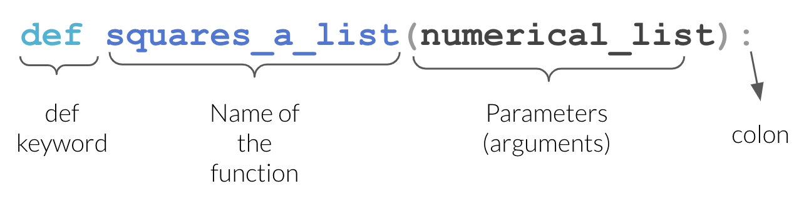

## For Today

#### Requirements

- ✅ Conditions and loops
- ✅ Building a list inside a loop

#### Programme

1. Writing functions
2. Arguments and scope
3. Modules and packages
4. Paths, and getting data into Colab
5. Getting help

# 1. Writing Functions

## Functions You Already Use

```{python}
print(len([1, 2, 3]))
print(round(3.14159, 2))
print(sum([1, 2, 3]))
```

- You give **inputs** in the brackets: the *arguments*
- You get an **output** back: the *return value*
- You have no idea how `sum()` is written internally, and you do not need to

Writing your own is the same idea, applied to your problem: **one definition** to fix, a
**name** that says what the code means, and code you **test once** and trust everywhere.

## def

```{python}
def add_vat(net):
    gross = net * 1.23
    return gross
```

{width="65%" fig-align="center"}

::: {.small-font}
Source: UBC Master of Data Science, [Programming in Python for Data Science](https://prog-learn.mds.ubc.ca/)
:::

- `net` is the **parameter**: a name that exists inside the function
- Colon, then an indented block. `return` sends a value back to the caller.

Defining a function **runs nothing**. It only creates the tool.

## Calling a Function

```{python}
print(add_vat(100))
print(add_vat(1847.35))
```

The value in the brackets is the **argument**. It is copied into the parameter `net` for the duration of the call.

```{python}
invoice = 250
print(add_vat(invoice))
```

## return vs print

The most common beginner confusion: two functions that differ only in their last line.

:::: {.code-columns}
::: {#first-column}
```{python}
def add_vat_print(net):
    print(net * 1.23)

a = add_vat_print(100)
print("a is", a)
```

`123.0` is printed **inside** the function, but nothing comes back: `a` is `None`.
:::

::: {#second-column}
```{python}
def add_vat_return(net):
    return net * 1.23

b = add_vat_return(100)
print("b is", b)
```

The value comes **back**: `b` is `123.0`, ready to use, as in `b * 2`.
:::
::::

**`print` shows a human. `return` gives a value back to the program.** Analysis functions return.

## Docstrings

The first string inside a function documents it.

```{python}
def add_vat(net, rate=0.23):
    """Return the gross amount for a net amount and a VAT rate.

    net:  the amount before VAT, in euros
    rate: the VAT rate as a decimal, 0.23 by default
    """
    return net * (1 + rate)

help(add_vat)
```

Three lines of docstring now save you an hour in March.

## Your Turn: Your First Functions {background="#43464B"}

Write each function, with a one-line docstring:

1. `celsius_to_fahrenheit(c)` returns `c * 9/5 + 32`
2. `margin(revenue, cost)` returns `(revenue - cost) / revenue * 100`, rounded to 1 decimal
3. `grade(mark)` returns `"First"` from 70, `"Pass"` from 40, `"Fail"` below 40

:::: {layout="[1,1]"}
::: {#first-column}
Then check them:

```{.python}
celsius_to_fahrenheit(100)  # 212.0
margin(1000, 620)           # 38.0
grade(64)                   # 'Pass'
```
:::

::: {#second-column}
::: {#timer1 .timer seconds="360" starton="interaction"}
:::
:::
::::

## Solution

```{python}
def celsius_to_fahrenheit(c):
    """Convert a temperature from Celsius to Fahrenheit."""
    return c * 9/5 + 32

def margin(revenue, cost):
    """Return the profit margin as a percentage, to 1 decimal."""
    return round((revenue - cost) / revenue * 100, 1)

def grade(mark):
    """Return First, Pass or Fail for a mark out of 100."""
    if mark >= 70:
        return "First"
    elif mark >= 40:
        return "Pass"
    return "Fail"

print(celsius_to_fahrenheit(100), margin(1000, 620), grade(64))
```

`return` ends the function on the spot, so `grade()` needs no `else`.

# 2. Arguments and Scope

## Positional and Keyword Arguments

Values given **by position** fill the parameters from left to right:

```{python}
def net_profit(revenue, cost, tax_rate):
    gross = revenue - cost
    return gross * (1 - tax_rate)

print(net_profit(10000, 6000, 0.125))
# revenue=10000, cost=6000, tax_rate=0.125: right

print(net_profit(0.125, 6000, 10000))
# revenue=0.125, cost=6000, tax_rate=10000: wrong, and no error
```

Write the names yourself (**keywords**) and the order stops mattering:

```{python}
print(net_profit(tax_rate=0.125, revenue=10000, cost=6000))
```

Use keywords whenever a function takes more than two arguments.

## Default Values

```{python}
def add_vat(net, rate=0.23):
    return net * (1 + rate)

print(add_vat(100))            # uses the default
print(add_vat(100, 0.135))     # overrides it
print(add_vat(100, rate=0.09))
```

- Parameters with defaults are **optional**
- They must come after the parameters without defaults
- This is how `round(x)` and `round(x, 2)` can both work

## Scope

Names created inside a function only exist inside it.

```{python}
#| error: true
def compute():
    hidden = 42
    return hidden * 2

print(compute())
print(hidden)
```

This is a feature: a function cannot silently break the rest of your notebook.

## Scope, The Other Direction

A function **can** read names from outside:

```{python}
vat_rate = 0.23

def add_vat_global(net):
    return net * (1 + vat_rate)   # reads the outside name

print(add_vat_global(100))
```

::: {.callout-warning}
This works, and it is a trap. The function now depends on something invisible in its own definition. Change `vat_rate` elsewhere and the function quietly changes behaviour. **Pass what you need as a parameter.**
:::

## Functions Calling Functions

```{python}
def add_vat(net, rate=0.23):
    return net * (1 + rate)

def invoice_total(prices, rate=0.23):
    """Return the gross total of a list of net prices."""
    total = 0
    for price in prices:
        total += add_vat(price, rate)
    return round(total, 2)

print(invoice_total([10.0, 25.0, 8.5]))
print(invoice_total([10.0, 25.0, 8.5], rate=0.09))
```

Small functions combined beat one large one, every time.

## Returning Several Values

```{python}
def describe(values):
    """Return the count, total and mean of a list of numbers."""
    n = len(values)
    total = sum(values)
    return n, total, total / n

count, total, mean = describe([120, 135, 148, 160])
print(count, total, round(mean, 1))
```

Python returns a **tuple**, which you unpack exactly as in lecture 3.

## Your Turn: A Reusable Summary {background="#43464B"}

:::: {layout="[1,1]"}
::: {#first-column}
**Several return values**

```{.python}
sales = [120, 135, 148, 160, 240]
```

1. Write `summarise(values)` returning the min, max, mean and range (max minus min)
2. Unpack `summarise(sales)` into four names and print them
:::

::: {#second-column}
**A default value**

3. Write `clean(text, lower=True)`: it always strips the spaces, and lowercases only if `lower` is `True`
4. Check it:

```{.python}
clean(" DCU ")               # 'dcu'
clean(" DCU ", lower=False)  # 'DCU'
```

::: {#timer2 .timer seconds="360" starton="interaction"}
:::
:::
::::

## Solution

```{python}
sales = [120, 135, 148, 160, 240]
def summarise(values):
    """Return the min, max, mean and range of a list of numbers."""
    lo = min(values)
    hi = max(values)
    mean = sum(values) / len(values)
    return lo, hi, mean, hi - lo

lo, hi, mean, spread = summarise(sales)
print(f"min {lo}, max {hi}, mean {mean:.2f}, range {spread}")
```

```{python}
def clean(text, lower=True):
    """Strip a string, and lowercase it unless lower is False."""
    text = text.strip()
    if lower:
        text = text.lower()
    return text

print(clean(" DCU "), clean(" DCU ", lower=False))
```

# 3. Modules and Packages

## Python Comes With Batteries

The **standard library** is installed with Python. You just have to `import` it.

:::: {.code-columns}
::: {#first-column}
```{python}
import math

print(math.sqrt(144))
print(math.pi)
print(math.log(100, 10))
```
:::

::: {#second-column}
```{python}
import random
import statistics

random.seed(42)    # reproducible
print(random.randint(1, 6))
print(random.choice(["A", "B", "C"]))

values = [120, 135, 148, 160, 240]
print(statistics.mean(values))
print(statistics.median(values))
```
:::
::::

`math.sqrt` reads as *"the sqrt function from the math module"*. The dot means "inside".

## Three Ways to Import

:::: {.code-columns}
::: {#first-column}
```{python}
#| eval: false
import math            # math.sqrt(16)
import pandas as pd    # pd.read_csv()
from math import sqrt  # sqrt(16)
from math import *     # never do this
```

- `import x`: safest, always clear where a function comes from
- `import x as y`: the standard for the big data libraries
- `from x import y`: convenient, but hides the origin
:::

::: {#second-column}
```{python}
#| eval: false
import numpy as np
import pandas as pd
import matplotlib.pyplot as plt
import seaborn as sns
import statsmodels.formula.api as smf
```

These five lines open almost every data analysis notebook in the world. **Use exactly these aliases**: any code you find online assumes them.
:::
::::

## Installing vs Importing

A **package** is a collection of modules (`.py` files). Apart from the standard library, every
package has to be **installed** before it can be imported:

- **Install** once per machine or environment: `!pip install seaborn` in Colab
- **Import** once per session: `import seaborn as sns` in each notebook

```{python}
#| error: true
import definitely_not_a_real_package
```

`ModuleNotFoundError` means it is not installed, or the name is misspelt. In Colab, every
library we use this semester is already installed.

# 4. Paths and Getting Data Into Colab

## Four Formats, Four Readers

Week 3 introduced CSV, JSON, Excel and Parquet. pandas reads all four, and the pattern is
always the same: `pd.read_something(where_it_is)`.

```{python}
#| eval: false
import pandas as pd

stores  = pd.read_csv("roasted_stores.csv")
sales   = pd.read_excel("quarterly_report.xlsx", sheet_name="Q1")
orders  = pd.read_json("orders.json")
daily   = pd.read_parquet("roasted_daily.parquet")
```

Four different files on disk, four one-line calls, and **the same DataFrame out of each**.
`read_excel` needs the **openpyxl** package and `read_parquet` needs **pyarrow**: Colab has
both, and next week you install them yourself.

## But Where Is the File?

`pd.read_csv("roasted_stores.csv")` looks for that file **on the machine running Python**. In
Colab, that machine is in a Google data centre, and your file is on your laptop. To bridge the
gap, you need to say **where a file is**: its path.

```{.default}
/Users/damien/Documents/BAA1118/data/roasted_stores.csv
└─┬──┘ └──┬─┘ └───┬────┘ └──┬───┘ └─┬─┘ └────────┬─────────┘
 root   user    folder    folder  folder      file name
```

- **Absolute**: starts at the root, `/Users/...` on a Mac, `C:/Users/...` on Windows,
  `/content/...` in Colab, and works on no other machine
- **Relative**: starts from wherever Python currently is, and travels with the project
- Folders are separated by `/`. Windows writes `\` but accepts `/`: always give it `/`

## The Colab Filesystem

Colab's computer has its own disk. You start in its `/content` folder:

```{.default}
/content               ← you start here
├── sample_data/       ← put there by Google
└── sales.csv          ← a file you uploaded
```

:::: {layout="[1,1]"}
::: {#first-column}
**Look around**: `!` runs a line in the terminal, not in Python

```{.python}
!pwd
!ls
```

```
/content
sales.csv  sample_data
```

Everything in `/content` is **deleted** when the runtime stops.
:::

::: {#second-column}
**Copy the path, never type it**

1. Click the **folder icon** in the left sidebar
2. Right-click your file, choose **Copy path**
3. Paste it between the quotes:

`pd.read_csv("/content/sales.csv")`
:::
::::

## Three Paths That Will Not Work

```{python}
#| eval: false
# 1. Incomplete: where does /path start? Nowhere on this machine.
pd.read_csv("/path/to/my/file.csv")

# 2. Missing the extension: "file" and "file.csv" are different names
pd.read_csv("C:/Users/damien/data/file")

# 3. Backslashes in a normal string: \t and \f are not folders
pd.read_csv("C:\Users\damien\data\file.csv")
```

The third one is the cruel one. `\t` means tab and `\f` means form feed, so Python never
even sees the folder names. Use forward slashes, or put an `r` before the quote:
`r"C:\Users\damien\data\file.csv"`.

## FileNotFoundError Is Not Mysterious

```{.default}
FileNotFoundError: [Errno 2] No such file or directory: 'stores.csv'
```

Ignore the twenty lines of traceback above it and read that last line: it means exactly
what it says. Then four checks, in order:

1. `!pwd` and `!ls`: am I where I think I am, and is the file there?
2. Is the **extension** in the name? Windows and macOS both hide them by default.
3. Is the **spelling and the capitalisation** right? Windows and macOS ignore capitals, but
   Colab runs on Linux, where `Stores.csv` and `stores.csv` are **two different files**.
4. Did I copy the path, or type it?

## Options 1 and 2: A URL or an Upload

Three ways to put a file where Colab can see it, and what each one costs.

**1. Read straight from a URL**, if the file is on the public internet:

```{python}
#| eval: false
url = "https://raw.githubusercontent.com/damien-dupre/data/refs/heads/master/gapminder.csv"
gapminder = pd.read_csv(url)
```

One line, it survives a restart, and every dataset in this module is hosted this way.
**But** only for public files: your employer's sales data is not.

**2. Upload by hand**, which works for anything, including private data:

```{python}
#| eval: false
from google.colab import files
uploaded = files.upload()          # opens a file picker
sales = pd.read_csv("my_sales.csv")
```

**But** the file lives in the runtime and disappears with it, so you upload it again every session.

## Option 3: Mount Google Drive

```{python}
#| eval: false
from google.colab import drive
drive.mount("/content/drive")
sales = pd.read_csv("/content/drive/MyDrive/BAA1118/data/my_sales.csv")
```

- The file persists between sessions, because it is in Drive
- **But**: you authorise it in a pop-up every session, and your data has to live in Drive
- **But**: look at that path. `/content/drive/MyDrive/...` is not where your file is.

::: {.callout-important}
All three options are workarounds for one fact: **the file is not on the machine running
your code.** Next week we move Python onto the machine where your files already are, and
`pd.read_csv("data/my_sales.csv")` becomes the only line.
:::

## Your Turn: Modules and Data {background="#43464B"}

```{.python}
url = "https://raw.githubusercontent.com/damien-dupre/data/refs/heads/master/gapminder.csv"
```

1. `pandas`: read `url` with `pd.read_csv()`, then print its `.shape` (rows, columns)

:::: {layout="[1,1]"}
::: {#first-column}
You should see:

```
13.17 13.5 6.18
[2, 5, 1, 3, 1, 4, 4, 4, 6, 4]
(1704, 6)
```
:::

::: {#second-column}
::: {#timer3 .timer seconds="300" starton="interaction"}
:::
:::
::::

## Solution

```{python}
import pandas as pd
url = "https://raw.githubusercontent.com/damien-dupre/data/refs/heads/master/gapminder.csv"
gapminder = pd.read_csv(url)
print(gapminder.shape)
```

# 5. Getting Help

## help() and Signatures

```{python}
help(round)
```

The first line is the **signature**. A parameter with no default, like `number`, is
**required**; anything with an `=` is optional. `pd.read_csv()` has dozens of parameters, and
only the first, the file, is required.

In Colab, `round?` shows the same help in a panel, and <kbd>Shift</kbd>+<kbd>Tab</kbd> inside
the brackets shows the arguments as you type. You are not expected to memorise these. You are
expected to **find them**.

## Where to Look, In Order

1. `help(function)` or <kbd>Shift</kbd>+<kbd>Tab</kbd> in the notebook
2. The official documentation: [docs.python.org](https://docs.python.org), [pandas.pydata.org](https://pandas.pydata.org/docs/)
3. A search engine, with the library name in the query
4. An AI assistant, asking it to **explain** rather than just produce
5. Stack Overflow, reading the accepted answer *and* the comments below it

Ask an assistant for *"a Python function `add_vat(net, rate=0.23)` that returns the gross
amount rounded to 2 decimals, with a docstring and three test calls"*, not for *"a function
for vat"*. The **signature is yours**: you decide what the function looks like, and the
assistant fills it in.

## Before Next Lecture

::: {.callout-important}
Next week is a **practical setup lecture**: Python moves off Colab and onto your own laptop.
Bring it, charged, with administrator rights if it is a work machine.
:::

If you can, download these two installers for your operating system **in advance**. DCU wifi will not enjoy 60 people downloading them at once.

- Python 3.12 or 3.13: [python.org/downloads](https://www.python.org/downloads/)
- VS Code: [code.visualstudio.com](https://code.visualstudio.com/)

**Do not run them yet.** We do it together, in order: on Windows there is a checkbox on the
first screen that must be ticked, and on macOS there is a step to run **after** the installer
finishes.

## {background="#43464B"}

```{=html}
<style>img.circle {border-radius:50%;}</style>
```

:::: {layout="[1,1]"}
::: {#first-column}


:::
::: {#second-column}
**Thanks for your attention and don't hesitate to ask if you have any questions!**

[ @damien_dupre](https://datasci.social/@damien_dupre)

[ @damien-dupre](https://github.com/damien-dupre)

[ https://damien-dupre.github.io](https://damien-dupre.github.io)

[ damien.dupre@dcu.ie](mailto:damien.dupre@dcu.ie)
:::
::::
