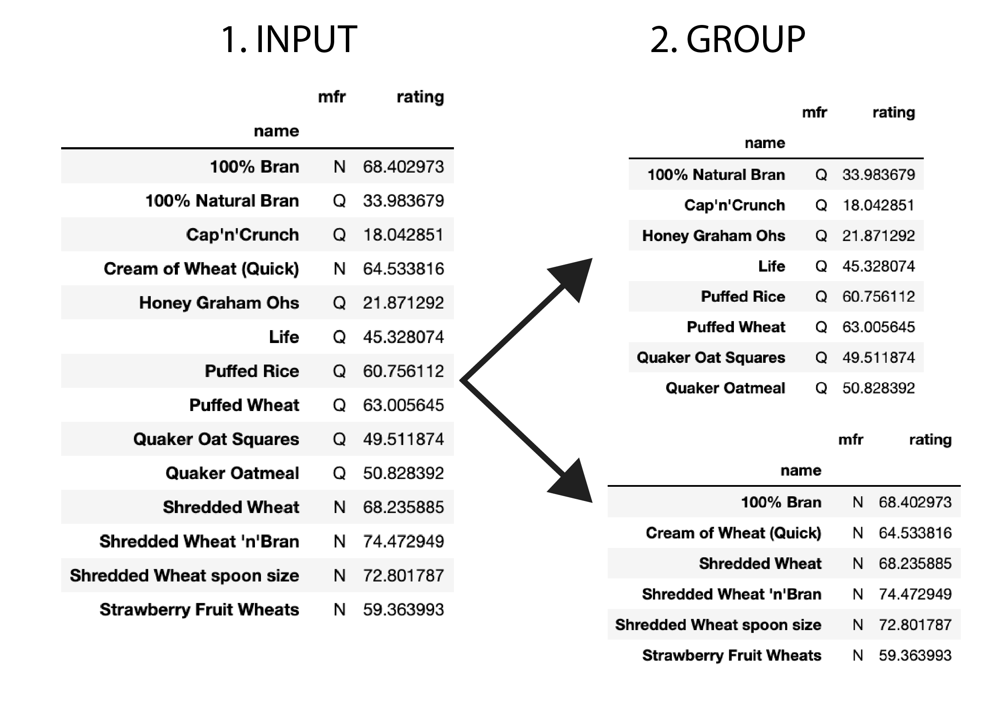
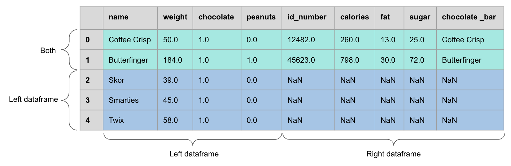

```{python}
#| echo: false
import pandas as pd
pd.set_option("display.max_rows", 8)
pd.set_option("display.width", 100)
```

## pandas and DataFrames

`pandas` is Python's library for tables, imported as `pd`:

```{python}
import pandas as pd
capitals = pd.DataFrame({"country": ["Ireland", "France", "Japan"],
                         "capital": ["Dublin", "Paris", "Tokyo"]})
capitals
```

- A **DataFrame**: named columns, and rows labelled by an **index**
- Each key of the dictionary becomes a column, and its list the column's values
- One column on its own, `capitals["capital"]`, is a **Series**

## Five Operations

Almost every data question needs only five operations:

| Operation | What it does | In pandas |
|:--|:--|:--|
| **Selection** | keeps columns | `df[["a", "b"]]` |
| **Reduction** | keeps rows | `df[df["a"] > 0]` |
| **Extension** | adds a column | `df["c"] = df["a"] * 2` |
| **Aggregation** | one row per group | `df.groupby("a")["b"].mean()` |
| **Combination** | joins two tables | `df.merge(other, on="a")` |

`df` is any table, and `a`, `b` and `c` are its columns. Each operation has its own section,
in this order.

## The gapminder Dataset

Each row is **a country in a given year**, every five years from 1952 to 2007: `country`,
`continent`, `year`, `lifeExp` (in years), `pop` and `gdpPercap` (in US$).

```{python}
url = "https://raw.githubusercontent.com/damien-dupre/data/refs/heads/master/gapminder.csv"
gapminder = pd.read_csv(url)
gapminder.head(3)
```

`pd.read_csv()` reads a CSV file into a DataFrame; `.head(3)` shows its first 3 rows.

## A First Look

```{python}
print(gapminder.shape)      # (rows, columns): a value, so no round brackets
gapminder.info()
```

`info()` gives each column's type and how many values are present. `str` is text: older
tutorials and AI assistants show `object`, from pandas 2.

## describe() and value_counts()

:::: {.code-columns}
::: {#first-column}
```{python}
gapminder["lifeExp"].describe()
```
:::

::: {#second-column}
```{python}
gapminder["continent"].value_counts()
```
:::
::::

- `describe()` gives the range and the quartiles: look for impossible values, such as a
  negative population
- `value_counts()` counts the rows for each value, most frequent first

## Your Turn: A First Look {background="#43464B"}

Replace each `____`, using the comments, then run the cell:

```{.python}
import pandas as pd
url = "https://raw.githubusercontent.com/damien-dupre/data/refs/heads/master/gapminder.csv"
gapminder = pd.read_csv(url)
print(gapminder.____)                    # rows and columns, with .shape
print(gapminder["country"].____())       # how many countries, with .nunique()
print(gapminder["continent"].____())     # rows per continent, with .value_counts()
```

:::: {layout="[3,2]"}
::: {#first-column}
You should see `(1704, 6)`, then `142`, then Africa first, with 624 rows.
:::

::: {#second-column}
::: {#timer1 .timer seconds="300" starton="interaction"}
:::
:::
::::

## Solution

```{python}
import pandas as pd
url = "https://raw.githubusercontent.com/damien-dupre/data/refs/heads/master/gapminder.csv"
gapminder = pd.read_csv(url)
print(gapminder.shape)
print(gapminder["country"].nunique())
print(gapminder["continent"].value_counts())
```

# 1. Selecting Columns

## Selecting Columns

:::: {.code-columns}
::: {#first-column}
A **list** of names, so two pairs of square brackets: a **DataFrame**

```{python}
gapminder[["country", "pop"]].head(3)
```
:::

::: {#second-column}
One name, one pair of square brackets: a **Series**

```{python}
gapminder["pop"].head(3)
```
:::
::::

- Keep only the columns a question needs: tables often have dozens
- The names must be spelt exactly as in the table, capitals included

## Renaming Columns

```{python}
renamed = gapminder.rename(columns={"pop": "population"})
renamed.head(3)
```

- `rename()` takes a dictionary, `{old name: new name}`
- It **returns** a new table: store it, or nothing changes
- `gapminder` itself is unchanged: the next slides still use its own names

## Your Turn: Select and Rename {background="#43464B"}

Replace each `____`, using the comments, then run the cell. Column names go in quotes:

```{.python}
import pandas as pd
url = "https://raw.githubusercontent.com/damien-dupre/data/refs/heads/master/gapminder.csv"
gapminder = pd.read_csv(url)
small = gapminder[["country", "year", ____]]        # keep "lifeExp" too
small = small.rename(columns={"lifeExp": ____})    # call it "life"
small.head(3)
```

:::: {layout="[3,2]"}
::: {#first-column}
You should see the columns `country`, `year` and `life`, and Afghanistan in 1952 with
28.801.
:::

::: {#second-column}
::: {#timer2 .timer seconds="300" starton="interaction"}
:::
:::
::::

## Solution

```{python}
import pandas as pd
url = "https://raw.githubusercontent.com/damien-dupre/data/refs/heads/master/gapminder.csv"
gapminder = pd.read_csv(url)
small = gapminder[["country", "year", "lifeExp"]]
small = small.rename(columns={"lifeExp": "life"})
small.head(3)
```

# 2. Filtering and Sorting Rows

## Filtering Rows

```{python}
gapminder[gapminder["country"] == "Ireland"].head(3)
```

- `gapminder["country"] == "Ireland"` gives `True` or `False` for every row
- The square brackets around it keep the rows that are `True`
- The numbers on the left are the **index**: each row keeps its label, here 744 to 746
- Text goes in quotes, `"Ireland"`; numbers do not: `gapminder["year"] == 2007`

## Comparisons

| Operator | Means |
|:--|:--|
| `==` | exactly equal |
| `!=` | not equal |
| `>` and `>=` | greater than, greater than or equal |
| `<` and `<=` | less than, less than or equal |

The easiest mistake to make is one `=` instead of two:

```{.python}
gapminder[gapminder["country"] = "Ireland"]
```

```
SyntaxError: cannot assign to subscript here. Maybe you meant '==' instead of '='?
```

`=` stores a value, `==` compares two. Python stops, and suggests the fix.

## Several Conditions, Several Values

```{python}
recent = gapminder[(gapminder["year"] >= 2000) &
                   (gapminder["country"] == "Ireland")]
two = gapminder[gapminder["country"].isin(["Ireland", "France"])]
nineties = gapminder[gapminder["year"].between(1990, 1999)]
print(len(recent), len(two), len(nineties))
```

- `&` for and, `|` for or, with **each condition in its own round brackets**. The words
  `and` and `or` do not work on columns
- `isin([...])` keeps any of several values; `between(a, b)` keeps a to b, both included
- `len()` of a table counts its rows: 2, 24 and 284 here

## Sorting Rows

```{python}
g2007 = gapminder[gapminder["year"] == 2007]
g2007.sort_values("lifeExp", ascending=False).head(3)
```

- `sort_values("lifeExp")` puts the smallest first; with `ascending=False`, the largest
- After a sort, `.head(3)` gives the top three: Japan first, at 82.6 years
- `g2007`, the 142 countries in 2007, comes back in sections 4 and 5

## Your Turn: Filter {background="#43464B"}

Replace each `____`, using the comments, then run the cell:

```{.python}
import pandas as pd
url = "https://raw.githubusercontent.com/damien-dupre/data/refs/heads/master/gapminder.csv"
gapminder = pd.read_csv(url)
france = gapminder[gapminder["country"] == ____]     # the rows of "France"
france_1982 = france[france[____] == 1982]           # the column of the "year"
print(len(france), len(france_1982))
france_1982
```

:::: {layout="[3,2]"}
::: {#first-column}
You should see `12 1`, then France in 1982, with a `lifeExp` of 74.89.
:::

::: {#second-column}
::: {#timer3 .timer seconds="300" starton="interaction"}
:::
:::
::::

## Solution

```{python}
import pandas as pd
url = "https://raw.githubusercontent.com/damien-dupre/data/refs/heads/master/gapminder.csv"
gapminder = pd.read_csv(url)
france = gapminder[gapminder["country"] == "France"]
france_1982 = france[france["year"] == 1982]
print(len(france), len(france_1982))
france_1982
```

Text goes in quotes, `"France"`; numbers do not, `1982`.

# 3. Creating Columns

## Creating Columns

```{python}
gapminder["gdp_bn"] = gapminder["pop"] * gapminder["gdpPercap"] / 1_000_000_000
gapminder["pop_m"] = (gapminder["pop"] / 1_000_000).round(1)
gapminder[["country", "year", "pop_m", "gdp_bn"]].head(3)
```

- `gdp_bn` is the GDP in billions of US$, `pop_m` the population in millions: the `_` in
  `1_000_000` only makes the number easier to read
- A new name on the left creates a column; an existing name replaces it
- The calculation runs on **every row at once**, with no loop
- Text columns have their own methods, after `.str`: `gapminder["country"].str.upper()`

## Your Turn: New Columns {background="#43464B"}

Replace each `____`, using the comments, then run the cell:

```{.python}
import pandas as pd
url = "https://raw.githubusercontent.com/damien-dupre/data/refs/heads/master/gapminder.csv"
gapminder = pd.read_csv(url)
gapminder["country_upper"] = gapminder["country"].str.____()   # with .str.upper()
gapminder["life_months"] = gapminder[____] * 12                # "lifeExp", in months
gapminder[["country_upper", "life_months"]].head(3)
```

:::: {layout="[3,2]"}
::: {#first-column}
You should see `AFGHANISTAN` and `345.612` on the first row.
:::

::: {#second-column}
::: {#timer4 .timer seconds="300" starton="interaction"}
:::
:::
::::

## Solution

```{python}
import pandas as pd
url = "https://raw.githubusercontent.com/damien-dupre/data/refs/heads/master/gapminder.csv"
gapminder = pd.read_csv(url)
gapminder["country_upper"] = gapminder["country"].str.upper()
gapminder["life_months"] = gapminder["lifeExp"] * 12
gapminder[["country_upper", "life_months"]].head(3)
```

# 4. Summarising by Group

## One Number for a Column

```{python}
print(gapminder["lifeExp"].mean())
print(gapminder["lifeExp"].median())
print(gapminder["pop"].max())
```

- `mean()`, `median()`, `sum()`, `min()`, `max()`, `std()` and `count()` each turn a whole
  column into **one number**
- To round that number, Python's `round(x, 1)`; to round a column or a table, `.round(1)`

## One Number per Group

:::: {.code-columns}
::: {#first-column}
```{python}
groups = gapminder.groupby("continent")
groups["lifeExp"].mean()
```
:::

::: {#second-column}
{width="70%"}

::: {.small-font}
Source: UBC Master of Data Science, [Programming in Python for Data Science](https://prog-learn.mds.ubc.ca/)
:::
:::
::::

`groupby("continent")` **splits** the rows into groups, as in the picture;
`["lifeExp"].mean()` **applies** the mean to each group and **combines** the results, with
the continents as the index.

## One Step per Line

:::: {.code-columns}
::: {#first-column}
Step by step, one name per step:

```{python}
#| output: false
groups = g2007.groupby("continent")
means = groups["lifeExp"].mean()
means.sort_values(ascending=False)
```

The same steps as one **chain**:

```{python}
#| output: false
(g2007
  .groupby("continent")["lifeExp"]
  .mean()
  .sort_values(ascending=False)
)
```
:::

::: {#second-column}
Both give the mean life expectancy per continent in 2007, highest first:

```{python}
#| echo: false
means.sort_values(ascending=False)
```
:::
::::

Read each new line of a chain as **then**: take `g2007`, then group it by continent, then
take the mean, then sort. The round brackets let it run over several lines.

## Several Statistics at Once

```{python}
(g2007
  .groupby("continent")
  .agg(countries=("country", "nunique"),
       mean_life=("lifeExp", "mean"))
  .sort_values("mean_life", ascending=False)
)
```

- Inside `.agg()`, each statistic gets a name, then a column and a function:
  `mean_life=("lifeExp", "mean")`
- The next step can use that name: `.sort_values("mean_life")`

## Wide Tables: pivot_table

```{python}
wide = gapminder.pivot_table(index="continent", columns="year",
                             values="lifeExp", aggfunc="mean")
wide[[1952, 1977, 2007]].round(1)
```

- `index` gives the rows, `columns` the new columns, `values` and `aggfunc` the cells: an
  Excel pivot table in one line
- Lecture 7 turns it round, with the years as rows, and draws one line per continent

## Your Turn: Summarise {background="#43464B"}

Replace each `____`, using the comments, then run the cell:

```{.python}
import pandas as pd
url = "https://raw.githubusercontent.com/damien-dupre/data/refs/heads/master/gapminder.csv"
gapminder = pd.read_csv(url)
g2007 = gapminder[gapminder["year"] == 2007]
(g2007
  .groupby(____)                                       # by "continent"
  # the mean and the "median" of "gdpPercap"
  .agg(mean_gdp=(____, "mean"), median_gdp=("gdpPercap", ____))
  .sort_values("mean_gdp", ascending=____)             # highest first: False
  .round()
)
```

:::: {layout="[3,2]"}
::: {#first-column}
You should see Oceania first; in Asia, a mean of 12473 but a median of 4471.
:::

::: {#second-column}
::: {#timer5 .timer seconds="300" starton="interaction"}
:::
:::
::::

## Solution

```{python}
import pandas as pd
url = "https://raw.githubusercontent.com/damien-dupre/data/refs/heads/master/gapminder.csv"
gapminder = pd.read_csv(url)
g2007 = gapminder[gapminder["year"] == 2007]
(g2007
  .groupby("continent")
  .agg(mean_gdp=("gdpPercap", "mean"), median_gdp=("gdpPercap", "median"))
  .sort_values("mean_gdp", ascending=False)
  .round()
)
```

# 5. Joining Tables

## Joining Two Tables

Two tables share a **key**: here, the chocolate bar's name.

{.nostretch width="70%" fig-align="center"}

- `how="inner"`, the default, keeps the rows in **both** tables: rows 0 and 1
- `how="left"` keeps **every row of the left table**, `NaN` where nothing matched

::: {.small-font}
Source: UBC Master of Data Science, [Programming in Python for Data Science](https://prog-learn.mds.ubc.ca/)
:::

## merge() in Practice

```{python}
leads = pd.DataFrame({
    "continent": ["Africa", "Americas", "Asia", "Europe"],
    "lead": ["Ama", "Ben", "Chen", "Dana"],
})
joined = g2007.merge(leads, on="continent", how="left")
print(len(g2007), "rows before,", len(joined), "after;",
      joined["lead"].isna().sum(), "without a lead")
```

- `on=` names the key: a column in both tables, with matching values
- Oceania has no lead: its 2 countries get `NaN`, a missing value, which `.isna().sum()`
  counts
- With `how="inner"`, those 2 rows would disappear without a warning: **check the row count
  after every join**

## Your Turn: Join {background="#43464B"}

Replace each `____`, using the comments, then run the cell:

```{.python}
import pandas as pd
url = "https://raw.githubusercontent.com/damien-dupre/data/refs/heads/master/gapminder.csv"
gapminder = pd.read_csv(url)
g2007 = gapminder[gapminder["year"] == 2007]
capitals = pd.DataFrame({"country": ["Ireland", "France", "Japan"],
                         "capital": ["Dublin", "Paris", "Tokyo"]})
both = g2007.merge(capitals, on=____, how=____)     # on "country", how "inner"
print(len(both))
```

:::: {layout="[3,2]"}
::: {#first-column}
You should see `3`. Then change `"inner"` to `"left"` and run the cell again: `142`.
:::

::: {#second-column}
::: {#timer6 .timer seconds="300" starton="interaction"}
:::
:::
::::

## Solution

```{python}
import pandas as pd
url = "https://raw.githubusercontent.com/damien-dupre/data/refs/heads/master/gapminder.csv"
gapminder = pd.read_csv(url)
g2007 = gapminder[gapminder["year"] == 2007]
capitals = pd.DataFrame({"country": ["Ireland", "France", "Japan"],
                         "capital": ["Dublin", "Paris", "Tokyo"]})
inner = g2007.merge(capitals, on="country", how="inner")
left = g2007.merge(capitals, on="country", how="left")
print(len(inner), len(left))
```

`inner` keeps the 3 countries found in both tables; `left` keeps all 142, with `NaN` as the
capital of the other 139.

## When pandas Stops {.smaller}

| You see | Why | Fix |
|:--------|:------|:------|
| `KeyError: 'lifeExp'` | no column has that name: a typo, or it was renamed | check the names with `gapminder.columns` |
| `NameError: name 'country' is not defined` | a column name without quotes | `"country"`, in quotes |
| `SyntaxError: ... Maybe you meant '=='` | one `=` inside a filter | `==` |
| `ValueError: The truth value of a Series is ambiguous` | `and` or `or` between two conditions | `&` or <code>&#124;</code>, with each condition in round brackets |
| no error, but nothing changed | `rename()` returns a new table | `gapminder = gapminder.rename(...)` |
| rows missing after a join | `how="inner"`, the default, drops the rows with no match | `how="left"`, then check `len()` |

Read an error from its **last line**: it names the problem, and often the fix.

## References

- [10 minutes to pandas](https://pandas.pydata.org/docs/user_guide/10min.html): the official
  introduction
- [Comparison with spreadsheets](https://pandas.pydata.org/docs/getting_started/comparison/comparison_with_spreadsheets.html):
  Excel's filters, pivot tables and lookups, in pandas
- [Python for Data Analysis, 3rd edition](https://wesmckinney.com/book/): free online, by the
  creator of pandas
- [Programming in Python for Data Science](https://prog-learn.mds.ubc.ca/): UBC Master of
  Data Science, the source of two of this lecture's images
- [The pandas cheat sheet](https://pandas.pydata.org/Pandas_Cheat_Sheet.pdf): two pages, to
  print

## {background="#43464B"}

```{=html}
<style>img.circle {border-radius:50%;}</style>
```

:::: {layout="[1,1]"}
::: {#first-column}


:::
::: {#second-column}
**Thanks for your attention and don't hesitate to ask if you have any questions!**

[ @damien_dupre](https://datasci.social/@damien_dupre)

[ @damien-dupre](https://github.com/damien-dupre)

[ https://damien-dupre.github.io](https://damien-dupre.github.io)

[ damien.dupre@dcu.ie](mailto:damien.dupre@dcu.ie)
:::
::::
