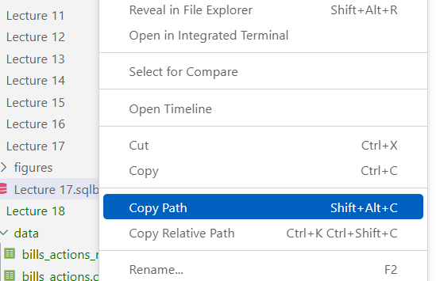

```{python}
#| echo: false
import numpy as np
import pandas as pd
import matplotlib.pyplot as plt
import statsmodels.formula.api as smf

pd.set_option("display.max_rows", 8)
pd.set_option("display.width", 100)
plt.rcParams["figure.figsize"] = (8, 2.4)
plt.rcParams["figure.dpi"] = 110
plt.rcParams["font.size"] = 11

```

# 1. Reading Paths

## Where Is the File?

A **path** is a file's address: the folders to open, from the top of the disk down to the
file.

```{.default}
Mac:      /Users/aoife/BAA1118/data/roasted_daily.csv
Windows:  C:\Users\aoife\BAA1118\data\roasted_daily.csv
```

Read it from left to right:

- `/`, or `C:\` on Windows: the **root**, the top of the disk
- `Users/aoife`: your **home folder**, named after you
- `BAA1118`, then `data`: two folders, each inside the one before. `BAA1118` is the course
  folder you made in tutorial 5
- `roasted_daily.csv`: the **file**, its name then its extension

## Absolute and Relative Paths

```{.python}
# absolute: starts at the root, so it works on Aoife's laptop only
sales = pd.read_csv("/Users/aoife/BAA1118/data/roasted_daily.csv")
# on Windows:       "C:/Users/aoife/BAA1118/data/roasted_daily.csv"

# relative: starts from the notebook's folder, so it works on any computer
sales = pd.read_csv("data/roasted_daily.csv")
```

- **Absolute**: from the root. Anyone else's computer has no `aoife` folder, so the same
  line fails there
- **Relative**: from the folder **the notebook is in**. It works wherever the notebook sits
  beside its `data` folder: use relative paths in your notebooks
- Write `/` on both systems: Python on Windows accepts it, and `\` causes trouble

## Where Is the Notebook Running?

`os`, a module that comes with Python, answers from inside the notebook:

```{.python}
import os
print(os.getcwd())                                # the folder relative paths start from
print(os.listdir())                               # what is in it
print(os.listdir("data"))                         # what is in its data folder
print(os.path.exists("data/roasted_daily.csv"))   # True if the path finds a file
```

```
/Users/aoife/BAA1118
['data', 'lecture_9.ipynb', 'tutorial_08.ipynb']
['roasted_daily.csv']
True
```

- `getcwd()`: get the **current working directory**. On Windows: `C:\Users\aoife\BAA1118`
- The first cell of the mock test, and of Test 2, uses `os.path.exists()` on its data

## A Notebook in a Subfolder

In VS Code, a notebook's relative paths start from **its own folder**, not from the folder
you opened:

```{.default}
BAA1118                       ← the folder open in VS Code
├── data
│   └── roasted_daily.csv
└── BAA1118_test2_mock        ← the notebook's folder: its paths start here
    ├── data
    │   └── lifeExpectancy.csv
    └── test2_mock.ipynb
```

In `test2_mock.ipynb`:

```{.python}
pd.read_csv("data/lifeExpectancy.csv")      # found: this data folder is beside it
pd.read_csv("data/roasted_daily.csv")        # FileNotFoundError: not in this one
pd.read_csv("../data/roasted_daily.csv")     # found: .. goes up one folder, to BAA1118
```

## Copy the Path, Never Type It

:::: {layout="[1,1]"}
::: {#first-column}
{width="100%"}

::: {.small-font}
Source: Danilo Freire, [DATASCI 151 lectures](https://github.com/danilofreire/datasci151)
:::
:::

::: {#second-column}
In VS Code's Explorer, right-click the file:

- **Copy Path**: the absolute path
- **Copy Relative Path**: from the folder **open in VS Code**, not from the notebook. Right
  only if the notebook sits in that folder
:::
::::

On Windows, both use `\`: change each one to `/`. In `"data\roasted_daily.csv"`, Python reads
`\r` as one character, a carriage return, and never finds the file.

## Your Turn: Read a Path {background="#43464B"}

In VS Code, open your `BAA1118` folder, then `File -> New File... -> Jupyter Notebook`. Save
it in `BAA1118` as `lecture_9.ipynb`, select your kernel as in the tutorials, and replace each
`____`:

```{.python}
import os
import pandas as pd
print(os.____())                                  # the notebook's folder, with getcwd
print(os.listdir(____))                           # what is in the "data" folder
print(os.path.exists("data/roasted_daily.csv"))   # True if the file is found
sales = pd.read_csv(____)                         # the file's relative path, in quotes
print(sales.shape)
```

:::: {layout="[3,2]"}
::: {#first-column}
You should see the path of your `BAA1118` folder, a list with `'roasted_daily.csv'` in it,
`True`, then `(1086, 10)`.
:::

::: {#second-column}
::: {#timer1 .timer seconds="300" starton="interaction"}
:::
:::
::::

## Solution

```{.python}
import os
import pandas as pd
print(os.getcwd())
print(os.listdir("data"))
print(os.path.exists("data/roasted_daily.csv"))
sales = pd.read_csv("data/roasted_daily.csv")
print(sales.shape)
```

```
/Users/aoife/BAA1118
['roasted_daily.csv']
True
(1086, 10)
```

On Windows, the first line is `C:\Users\aoife\BAA1118`. `False`, or a `FileNotFoundError`?
Compare the first two lines with the Explorer: is the notebook in `BAA1118`, and the file in
`data`?

# 2. Lectures 6 to 8 in Review

## Lecture 6: Wrangling with pandas

```{.python}
df = pd.read_csv("data/file.csv")               # read: a DataFrame
df.shape, df.head(3), df["a"].value_counts()    # look
df = df.rename(columns={"old": "new"})          # rename: store the new table
df[["a", "b"]]                                  # select: df["a"] alone is a Series
df[(df["a"] == "x") & (df["b"] > 0)]            # filter: & for and, | for or
df.sort_values("a", ascending=False)            # sort: the largest first
df["c"] = df["a"] * 2                           # create: every row at once
df.groupby("g")["a"].mean()                     # summarise: one number per group
df.groupby("g").agg(avg=("a", "mean"))          # several statistics, each named
df.merge(other, on="key", how="left")           # join: then check len()
```

- Five operations: **selection**, **reduction** (filter), **extension** (create),
  **aggregation** (summarise) and **combination** (join)
- Text in quotes, numbers without; `==` compares, `=` stores

## Your Turn: Wrangle {background="#43464B"}

**The 1952 countries.** Replace each `____`, using the comments:

```{.python}
import pandas as pd
url = "https://raw.githubusercontent.com/damien-dupre/data/refs/heads/master/gapminder.csv"
gapminder = pd.____(url)                            # read it, with read_csv
g1952 = gapminder[gapminder[____] == ____]          # the column "year", then 1952
g1952["pop_m"] = g1952[____] / 1_000_000            # "pop", in millions
(g1952
  .groupby(____)                                    # by "continent"
  .agg(countries=("country", ____), pop_m=("pop_m", ____))   # "nunique", then "sum"
  .sort_values("pop_m", ascending=____)             # largest first: False
  .round()
)
```

:::: {layout="[3,2]"}
::: {#first-column}
You should see Asia first, with 33 countries and 1395 million people.
:::

::: {#second-column}
::: {#timer2 .timer seconds="300" starton="interaction"}
:::
:::
::::

## Solution {.smaller}

```{python}
import pandas as pd
url = "https://raw.githubusercontent.com/damien-dupre/data/refs/heads/master/gapminder.csv"
gapminder = pd.read_csv(url)
g1952 = gapminder[gapminder["year"] == 1952]
g1952["pop_m"] = g1952["pop"] / 1_000_000
(g1952
  .groupby("continent")
  .agg(countries=("country", "nunique"), pop_m=("pop_m", "sum"))
  .sort_values("pop_m", ascending=False)
  .round()
)
```

In 1952, Asia already held more people than the four other continents together, and Africa
had the most countries, 52.

## Lecture 7: Visualisation with matplotlib

```{.python}
fig, ax = plt.subplots()                              # the canvas
ax.scatter(df["x"], df["y"], color="lightgrey")      # a geometry: x first, then y
ax.scatter(one["x"], one["y"], color="red")          # grey everything, colour one thing
ax.set_xscale("log")                                 # a scale
ax.set(xlabel="Income (US$)", ylabel="Life expectancy (years)")   # labels, with units
ax.set_title("A title that states the finding")      # the finding
plt.show()
fig.savefig("chart.png", dpi=300, bbox_inches="tight")
```

- **The question picks the geometry**: how two columns relate, `ax.scatter()`; a change
  over time, `ax.plot()`; one number per category, `ax.bar()` or `ax.barh()`; a spread,
  `ax.hist()` or `ax.boxplot()`
- After a `groupby()`, the groups are the index: `ax.bar(s.index, s.values)`
- Colour by group: a loop, one layer per group with `label=`, then `ax.legend()`

## Your Turn: Grey Bars, One Colour {background="#43464B"}

**The 2007 countries.** Replace each `____`, using the comments:

```{.python}
import pandas as pd
import matplotlib.pyplot as plt
url = "https://raw.githubusercontent.com/damien-dupre/data/refs/heads/master/gapminder.csv"
gapminder = pd.read_csv(url)
g2007 = gapminder[gapminder["year"] == 2007]
means = g2007.groupby("continent")[____].mean()     # the mean of "lifeExp"
low = means[means < ____]                           # the continents below 60 years
fig, ax = plt.____()                                # the canvas, with subplots
ax.____(means.index, means.values, color=____)      # bars, with .bar(); "lightgrey"
ax.bar(low.____, low.____, color=____)              # .index, .values; then "red"
ax.set(ylabel=____, title=____)                     # "... (years)", then the finding
plt.show()
```

:::: {layout="[3,2]"}
::: {#first-column}
You should see five grey bars, and Africa's in red, at about 55 years.
:::

::: {#second-column}
::: {#timer3 .timer seconds="300" starton="interaction"}
:::
:::
::::

## Solution {.smaller}

```{python}
#| echo: false
plt.rcParams["figure.figsize"] = (8, 1.6)     # display size only, to fit the slide
```

```{python}
import pandas as pd
import matplotlib.pyplot as plt
url = "https://raw.githubusercontent.com/damien-dupre/data/refs/heads/master/gapminder.csv"
gapminder = pd.read_csv(url)
g2007 = gapminder[gapminder["year"] == 2007]
means = g2007.groupby("continent")["lifeExp"].mean()
low = means[means < 60]                             # a Series filters like a table
fig, ax = plt.subplots()
ax.bar(means.index, means.values, color="lightgrey")
ax.bar(low.index, low.values, color="red")
ax.set(ylabel="Life expectancy (years)",
       title="Africa: the only continent below 60 years in 2007")
plt.show()
```

## Lecture 8: Statistics with statsmodels

```{.python}
df["x"].corr(df["y"])                                # r, from -1 to +1: straight lines
df[["x", "y", "z"]].corr()                           # every pair of columns at once
df["log_x"] = np.log(df["x"])                        # a curve? straighten it first
model = smf.ols("y ~ x + C(group)", data=df).fit()  # = becomes ~, + adds a predictor
model.params                                         # the estimates: Intercept, slopes
model.summary().tables[1]                            # std err, p-value, 95% CI
model.rsquared                                       # the share of the variation
model.predict(new)                                   # new: a DataFrame with x in it
train = df.sample(frac=0.75, random_state=1)         # fit on train, then measure
test = df.drop(train.index)                          # the misses on test: RMSE, MAE
```

- **Explanation**: the estimates and how sure we are, fitted on all the data
- **Prediction**: how far the guesses miss, on rows the model has never seen

## Lecture 8: Results in Words

Lecture 8's model of the 2007 countries, `lifeExp ~ log_gdp`:

- **b = 7.20**: one more unit of `log_gdp` **is associated with** 7.2 more years of life
  expectancy, never "causes"
- **95% CI 6.3 to 8.1**: slopes **compatible with the data**; 0 is not among them
- **p < 0.001** (`0.000` in the table): below 0.05, the slope is **significantly**
  different from 0. Not the probability that the result is true
- **R² = 0.65**: the model **accounts for 65%** of the variation between countries. The
  other 35% is how far countries sit above or below what their income predicts
- No prediction outside the data: incomes from \$278 to \$49,357

## Your Turn: Fit, Read, Predict {background="#43464B"}

**The 1977 countries.** Replace each `____`, using the comments:

```{.python}
import numpy as np
import pandas as pd
import statsmodels.formula.api as smf
url = "https://raw.githubusercontent.com/damien-dupre/data/refs/heads/master/gapminder.csv"
gapminder = pd.read_csv(url)
g1977 = gapminder[gapminder["year"] == 1977]
g1977["log_gdp"] = np.log(g1977["gdpPercap"])
model = smf.ols(____, data=g1977).fit()                   # lifeExp explained by log_gdp
print(model.____.round(2))                                # the estimates, with .params
print(round(model.____, 2))                               # R², with .rsquared
new = pd.DataFrame({"log_gdp": np.log([1000, 10000])})    # 1,000 and 10,000 US$
print(model.____(new).round(1))                           # with .predict()
```

:::: {layout="[3,2]"}
::: {#first-column}
You should see `-2.74` and `7.55`, then `0.66`, then `49.4` and `66.8` years.
:::

::: {#second-column}
::: {#timer4 .timer seconds="300" starton="interaction"}
:::
:::
::::

## Solution {.smaller}

```{python}
import numpy as np
import pandas as pd
import statsmodels.formula.api as smf
url = "https://raw.githubusercontent.com/damien-dupre/data/refs/heads/master/gapminder.csv"
gapminder = pd.read_csv(url)
g1977 = gapminder[gapminder["year"] == 1977]
g1977["log_gdp"] = np.log(g1977["gdpPercap"])
model = smf.ols("lifeExp ~ log_gdp", data=g1977).fit()
print(model.params.round(2))
print(round(model.rsquared, 2))
new = pd.DataFrame({"log_gdp": np.log([1000, 10000])})
print(model.predict(new).round(1))
```

In 1977, income accounted for 66% of the variation. Both incomes lie inside the data, from
\$371 to \$59,265.

# 3. How They Fit Together

## One Analysis, Three Lectures

```{python}
#| echo: false
from matplotlib.patches import FancyBboxPatch, FancyArrowPatch

steps = [
    ("Read", "pandas", "read_csv()", "a path or a URL"),
    ("Wrangle", "pandas", "groupby()", "select, filter,\ncreate, join"),
    ("Visualise", "matplotlib", "fig, ax", "plot first"),
    ("Model", "statsmodels", "smf.ols()", "estimate, test,\npredict"),
    ("Report", "in words", "model.params", "the numbers\nin a sentence"),
]
fig, ax = plt.subplots(figsize=(10.8, 3.4))
ax.set_xlim(-0.5, 101)
ax.set_ylim(-3, 37)
ax.axis("off")
w, h, gap, y0 = 17.4, 19.0, 3.2, 8.5
xs = [0.4 + i * (w + gap) for i in range(len(steps))]
for x, (title, lib, code, words) in zip(xs, steps):
    ax.add_patch(FancyBboxPatch((x, y0), w, h, boxstyle="round,pad=0.2,rounding_size=1.5",
                                facecolor="#eeeeee", edgecolor="#23373b", linewidth=1.3))
    ax.text(x + w / 2, y0 + h - 3.0, title, ha="center", va="center", fontsize=17,
            fontweight="bold", color="#23373b")
    ax.text(x + w / 2, y0 + h - 7.0, lib, ha="center", va="center", fontsize=12.5,
            color="#555555")
    ax.text(x + w / 2, y0 + h - 10.6, code, ha="center", va="center", fontsize=12,
            family="monospace", color="#1a292c")
    ax.text(x + w / 2, y0 + 3.6, words, ha="center", va="center", fontsize=12,
            color="#1a292c", linespacing=1.2)
for x in xs[:-1]:
    ax.add_patch(FancyArrowPatch((x + w + 0.25, y0 + h / 2), (x + w + gap - 0.25, y0 + h / 2),
                                 arrowstyle="-|>", mutation_scale=17, color="#23373b", lw=1.6))
for i_from, i_to, label in [(0, 1, "Lecture 6"), (2, 2, "Lecture 7"), (3, 4, "Lecture 8")]:
    x1, x2, yb = xs[i_from] + 0.5, xs[i_to] + w - 0.5, y0 + h + 1.5
    ax.plot([x1, x1, x2, x2], [yb, yb + 1.4, yb + 1.4, yb], color="#eb811b", lw=1.5)
    ax.text((x1 + x2) / 2, yb + 4.0, label, ha="center", va="center", fontsize=14.5,
            color="#eb811b", fontweight="bold")
x1, x2 = xs[2] + w / 2, xs[1] + w / 2
ax.add_patch(FancyArrowPatch((x1, y0 - 0.5), (x2, y0 - 0.5), connectionstyle="arc3,rad=-0.35",
                             arrowstyle="-|>", mutation_scale=17, color="#23373b", lw=1.3))
ax.text((x1 + x2) / 2, y0 - 7.8, "a curve? back to pandas for a log column", ha="center",
        va="center", fontsize=12, color="#23373b", style="italic")
plt.show()
```

- One road, three stretches: a question goes in, a sentence with numbers comes out
- It loops back to pandas: a curve needs a log column, as in lecture 8, and a test set needs
  `sample()` and `drop()`

## What Each Step Hands to the Next {.smaller}

| Step | Code | Hands on |
|:--|:--|:--|
| read | `df = pd.read_csv("data/file.csv")` | a **DataFrame** |
| wrangle | `df[df["year"] == 2007]`, `.merge()`, `df["log_x"] = ...` | a DataFrame: one row per case, a column for each variable the question needs |
| summarise | `s = df.groupby("g")["y"].mean()` | a **Series**: its index holds the groups, for `ax.bar(s.index, s.values)` |
| visualise | `ax.scatter(df["x"], df["y"])` | a **chart**: a straight line, or a curve to straighten first? |
| model | `model = smf.ols("y ~ x", data=df).fit()` | a **model**: its formula names the columns |
| report | `model.params["x"]`, `model.rsquared` | **numbers**, to put in words |

The **column names** tie the three lectures together: created in pandas, plotted with
matplotlib, named in the formula. A typo anywhere along the road stops it.

## One Question, Three Lectures: pandas

**Did the countries that lived longest in 1952 still live longest in 2007?**

```{python}
url = "https://raw.githubusercontent.com/damien-dupre/data/refs/heads/master/gapminder.csv"
gapminder = pd.read_csv(url)                                             # read
y1952 = gapminder[gapminder["year"] == 1952]                             # filter
y1952 = y1952[["country", "continent", "lifeExp"]]                      # select
y1952 = y1952.rename(columns={"lifeExp": "life_1952"})                  # rename
y2007 = gapminder[gapminder["year"] == 2007]
y2007 = y2007[["country", "lifeExp"]]
y2007 = y2007.rename(columns={"lifeExp": "life_2007"})
both = y1952.merge(y2007, on="country", how="left")                     # join
both["gain"] = both["life_2007"] - both["life_1952"]                     # create
print(len(y1952), len(both), round(both["gain"].mean(), 1))
```

One row per country, both years side by side: 142 rows before the join, 142 after. On
average, people lived 17.9 years longer in 2007 than in 1952.

## One Question, Three Lectures: matplotlib

```{python}
fell = both[both["gain"] < 0]
fig, ax = plt.subplots(figsize=(8, 1.45))
ax.scatter(both["life_1952"], both["life_2007"], color="lightgrey")
ax.scatter(fell["life_1952"], fell["life_2007"], color="red")
ax.plot([30, 80], [30, 80], color="black")              # where 2007 equals 1952
ax.set(xlabel="Life expectancy in 1952 (years)", ylabel="In 2007 (years)")
ax.set_title("Long lives in 1952 still meant long lives in 2007", loc="left")
plt.show()
```

**Plot first**: a straight line, so a straight-line model fits. Below the black line, in
red, life expectancy fell: Swaziland and Zimbabwe.

## One Question, Three Lectures: statsmodels

```{python}
model = smf.ols("life_2007 ~ life_1952", data=both).fit()
print(model.summary().tables[1])
print(round(model.rsquared, 2))
```

> Across 142 countries, each extra year of life expectancy in 1952 was associated with 0.77
> more years in 2007 (95% CI 0.66 to 0.87, p < 0.001). Life expectancy in 1952 accounts for
> 60% of the variation between countries in 2007.

## Your Turn: From Table to Finding {background="#43464B"}

```{.python}
import pandas as pd
import matplotlib.pyplot as plt
import statsmodels.formula.api as smf
url = "https://raw.githubusercontent.com/damien-dupre/data/refs/heads/master/gapminder.csv"
gapminder = pd.read_csv(url)
g2007 = gapminder[gapminder["year"] == 2007]
europe = g2007[g2007["continent"] == ____]          # lecture 6: "Europe"
europe["gdp_k"] = europe["gdpPercap"] / 1000     # in thousands of US$
fig, ax = plt.subplots()
ax.____(europe["gdp_k"], europe["lifeExp"])        # lecture 7: points, .scatter()
plt.show()
model = smf.ols(____, data=europe).fit()            # lecture 8: lifeExp by gdp_k
print(model.params.round(2))
```

:::: {layout="[3,2]"}
::: {#first-column}
**Europe in 2007**, one blank per lecture. You should see 30 points rising along a line,
then `72.27` and `0.21`.
:::

::: {#second-column}
::: {#timer5 .timer seconds="300" starton="interaction"}
:::
:::
::::

## Solution {.smaller}

```{python}
#| echo: false
plt.rcParams["figure.figsize"] = (8, 1.25)    # display size only, to fit the slide
```

```{python}
import pandas as pd
import matplotlib.pyplot as plt
import statsmodels.formula.api as smf
url = "https://raw.githubusercontent.com/damien-dupre/data/refs/heads/master/gapminder.csv"
gapminder = pd.read_csv(url)
g2007 = gapminder[gapminder["year"] == 2007]
europe = g2007[g2007["continent"] == "Europe"]
europe["gdp_k"] = europe["gdpPercap"] / 1000
fig, ax = plt.subplots()
ax.scatter(europe["gdp_k"], europe["lifeExp"])
plt.show()
model = smf.ols("lifeExp ~ gdp_k", data=europe).fit()
print(model.params.round(2))
```

In Europe in 2007, 1,000 US\$ more GDP per capita was associated with 0.21 more years.

## When the Code Stops {.smaller}

| You see | Why | Fix |
|:--|:--|:--|
| `FileNotFoundError` | the path does not start from the notebook's folder | `os.getcwd()`, then `os.listdir()` |
| `KeyError: 'lifeExp'` | no column has that name: a typo, or it was renamed | check `df.columns` |
| `NameError: name 'both' is not defined` | the cell that creates `both` has not run | run the cells above, in order |
| `ValueError: The truth value of a Series is ambiguous` | `and` or `or` between two conditions | `&` or <code>&#124;</code>, each condition in brackets |
| fewer rows after a join | `how="inner"` drops the rows with no match | `how="left"`, then `len()` |
| `PatsyError: ... name 'gdp' is not defined` | the formula names a column the table does not have | check `df.columns` |

Read an error from its **last line**: it names the problem, and often the fix.

# 4. What to Do With a Notebook

## A Notebook's Life at Work

```{python}
#| echo: false
steps = [
    ("Work", "in VS Code", "cell by cell", "code, results\nand text for a reader"),
    ("Check", "Restart, Run All", "relative paths", "it runs on\nanyone's computer"),
    ("Share", "a format per reader", "notebook, HTML", "a schedule,\na dashboard"),
]
fig, ax = plt.subplots(figsize=(10.8, 2.6))
ax.set_xlim(-0.5, 101)
ax.set_ylim(0, 25)
ax.axis("off")
w, h, gap, y0 = 28.5, 21.0, 4.8, 1.5
xs = [0.4 + i * (w + gap) for i in range(len(steps))]
for x, (title, line1, line2, words) in zip(xs, steps):
    ax.add_patch(FancyBboxPatch((x, y0), w, h, boxstyle="round,pad=0.2,rounding_size=1.5",
                                facecolor="#eeeeee", edgecolor="#23373b", linewidth=1.3))
    ax.text(x + w / 2, y0 + h - 3.3, title, ha="center", va="center", fontsize=17,
            fontweight="bold", color="#23373b")
    ax.text(x + w / 2, y0 + h - 7.6, line1, ha="center", va="center", fontsize=12.5,
            color="#eb811b", fontweight="bold")
    ax.text(x + w / 2, y0 + h - 11.3, line2, ha="center", va="center", fontsize=12,
            color="#555555")
    ax.text(x + w / 2, y0 + 4.2, words, ha="center", va="center", fontsize=12,
            color="#1a292c", linespacing=1.2)
for x in xs[:-1]:
    ax.add_patch(FancyArrowPatch((x + w + 0.4, y0 + h / 2), (x + w + gap - 0.4, y0 + h / 2),
                                 arrowstyle="-|>", mutation_scale=18, color="#23373b", lw=1.6))
plt.show()
```

- At work, others read your notebook: a colleague, a manager, an auditor, or you in six
  months
- So analysts take the same three steps every time, before anyone else sees their work

## Work: Cells and the Kernel

```{=html}
<style>
.nb-bar {display: flex; gap: 1.1em; align-items: center; background: #1f1f1f; color: #d4d4d4;
  font-size: 0.62em; padding: 0.45em 0.9em; border-radius: 8px; margin: 0.3em 0 0.9em 0;}
.nb-bar span {white-space: nowrap;}
.nb-bar .sep {border-left: 1px solid #777; height: 1.1em;}
.nb-bar .kernel {margin-left: auto; color: #ffffff;}
</style>
<div class="nb-bar"><span>+ Code</span><span>+ Markdown</span><span class="sep"></span>
<span>▷ Run All</span><span>↻ Restart</span><span>Clear All Outputs</span>
<span class="kernel">Python 3.14.10</span></div>
```

:::: {layout="[1,1]"}
::: {#first-column}
- **Code cells** and **Markdown cells**: each code cell's **output** is saved in the
  `.ipynb`
- The **kernel**, at the top right, runs the cells: **Python 3.14**, as in the tutorials
- It **remembers every name** a cell creates, until it restarts. `[1]`, `[2]`: the order in
  which the cells ran
:::

::: {#second-column}
::: {.small-font}
| Action | Keys |
|:--|:--|
| run, then move on | <kbd>Shift</kbd>+<kbd>Enter</kbd> |
| leave the cell | <kbd>Esc</kbd> |
| add a cell above, below | <kbd>Esc</kbd>, <kbd>A</kbd> or <kbd>B</kbd> |
| make it text, code | <kbd>Esc</kbd>, <kbd>M</kbd> or <kbd>Y</kbd> |
| delete it | <kbd>Esc</kbd>, <kbd>D</kbd> <kbd>D</kbd> |
| undo a deletion | <kbd>Esc</kbd>, <kbd>Z</kbd> |

The same keys on Windows and on a Mac.
:::
:::
::::

## Work: Write for a Reader

At work, the first cell answers the question, for a reader who reads nothing else:

```{.markdown}
# Life expectancy, 1952 to 2007

- **Question:** did the countries that lived longest in 1952 still live longest in 2007?
- **Data:** gapminder, 142 countries, in 1952 and in 2007
- **Finding:** yes: each extra year in 1952 was associated with 0.77 more years in 2007
```

- Then a Markdown cell before each step: what it does, and why, in one sentence
- Charts with a title that states the finding, and numbers with their units
- `+ Markdown`, or <kbd>Esc</kbd> then <kbd>M</kbd>; double-click to edit,
  <kbd>Shift</kbd>+<kbd>Enter</kbd> to show. In the tests, written answers go in the cells
  marked *Your answer*

## Check: Restart, Then Run All

- The kernel remembers names from cells you have since changed, deleted or run out of
  order: a notebook can work for you, and fail for everyone else
- **Restart**, which empties the kernel's memory, then **Run All**: every result now comes
  from the code above it. A cell stops? Fix it, then check again
- **Relative paths** only: `data/...`, never `/Users/aoife/...`
- **Nothing private**: outputs are saved in the file, so the `.head()` of a customer table
  travels with it. No passwords, and no personal data you may not share
- Then save: <kbd>Ctrl</kbd>+<kbd>S</kbd>, or <kbd>Cmd</kbd>+<kbd>S</kbd> on a Mac

## Share: One Notebook, Several Readers

| Reader | Send them | How |
|:--|:--|:--|
| a colleague who codes | the notebook and its `data` folder | a zip, or the team's Git repository |
| a manager or a client | the results, not the code | an HTML report, or a PDF printed from it |
| the same report every week | a scheduled notebook | re-run on new data, as Netflix and Meta do |
| numbers to watch every day | a dashboard | Power BI or Tableau, on the same data |

Ask who will read it before you choose: **the format follows the reader**.

## Share: Export to HTML

1. **Once only**: run `%pip install nbconvert` in a cell, then delete the cell
2. **Restart**, then **Run All**, then save
3. In the toolbar: `...`, then **Export**, then **HTML**. Save it beside the notebook
4. **Open the `.html` in any browser**: text, code, tables and charts in one file, no Python
   needed

- A PDF? Print the HTML from your browser
- Without the code, as reports for managers often are, in a terminal:

```{.bash}
jupyter nbconvert --to html --no-input lecture_9.ipynb
```

## Your Turn: From Notebook to Report {background="#43464B"}

1. In `lecture_9.ipynb`, add a Markdown cell at the very top (<kbd>Esc</kbd>, <kbd>A</kbd>,
   then <kbd>M</kbd>): a title, then the question, data and finding of one exercise
2. Click **Restart**, then **Run All**. A cell stops? Fix it, perhaps a `____` left blank
3. Once only: run `%pip install nbconvert` in a new cell, then delete that cell and save
4. `...`, then **Export**, then **HTML**, and open `lecture_9.html` in your browser

:::: {layout="[3,2]"}
::: {#first-column}
You should see your summary first, then the code, tables and charts: a report anyone can
open, without Python.
:::

::: {#second-column}
::: {#timer6 .timer seconds="300" starton="interaction"}
:::
:::
::::

## Hand In: From Loop to VS Code, and Back {.smaller}

The mock test and Test 2 each come as a zip: a notebook and its `data` folder.

1. **Unzip** it: on Windows, right-click, then *Extract All*; on a Mac, double-click it. A
   notebook opened from inside the zip has no `data` folder beside it
2. **Move** the unzipped folder into `BAA1118`, notebook and `data` together. On a DCU
   computer, leave it where it is
3. In VS Code, open `BAA1118` (on a DCU computer, the unzipped folder), then the notebook.
   Select the kernel that shows **Python 3.14**, or on a DCU computer the Python that VS
   Code offers
4. **Run the first cell**: `Ready. Data found: True`. `False`? See section 1, on paths
5. Work in order: code in the empty cells, sentences in the *Your answer* cells
6. **Save**, then **upload the `.ipynb` file** to Loop: the notebook only, not the data

Here the reader is the marker, who reads your code: so you hand in the notebook itself.

## Your Turn: The Mock Test Drill {background="#43464B"}

With the mock test from Loop, so that everything works first time on 26 November:

1. Download `BAA1118_test2_mock.zip`, unzip it, and move `BAA1118_test2_mock` into
   `BAA1118`
2. In VS Code, open `test2_mock.ipynb`, select your kernel, and run the first cell
3. Add a cell under it (<kbd>Esc</kbd>, <kbd>B</kbd>), run `print(os.getcwd())`, and save

:::: {layout="[3,2]"}
::: {#first-column}
You should see `Ready. Data found: True`, then a path that ends with `BAA1118_test2_mock`.
:::

::: {#second-column}
::: {#timer7 .timer seconds="300" starton="interaction"}
:::
:::
::::

## Test 2: Thursday 26 November

- In class, **one hour**, in a **notebook in VS Code**: you write and run the code, as in
  the tutorials and the mock test
- It covers the **pandas, matplotlib, statistics and regression** of lectures 6, 7 and 8:
  today's review
- The best revision: the mock test in one hour, then every Your Turn of lectures 6 to 9
  without the solution, then check

## References

- [Jupyter Notebooks in VS Code](https://code.visualstudio.com/docs/datascience/jupyter-notebooks):
  VS Code's own guide to cells, kernels, Run All and Export
- [nbconvert](https://nbconvert.readthedocs.io/en/latest/): turns a notebook into HTML, PDF
  or a script, with or without the code
- Notebooks run on a schedule, as reports: at
  [Netflix](https://netflixtechblog.com/notebook-innovation-591ee3221233) and at
  [Meta](https://engineering.fb.com/2023/08/29/security/scheduling-jupyter-notebooks-meta/)
- [os.path](https://docs.python.org/3/library/os.path.html): Python's functions for paths,
  `exists()` among them
- [Navigating Files and Directories](https://swcarpentry.github.io/shell-novice/02-filedir):
  absolute and relative paths, and `..`, by Software Carpentry
- [R for Data Science, Whole game](https://r4ds.hadley.nz/whole-game): the same road, from
  import to communication, in R

## {background="#43464B"}

```{=html}
<style>img.circle {border-radius:50%;}</style>
```

:::: {layout="[1,1]"}
::: {#first-column}


:::
::: {#second-column}
**Thanks for your attention and don't hesitate to ask if you have any questions!**

[ @damien_dupre](https://datasci.social/@damien_dupre)

[ @damien-dupre](https://github.com/damien-dupre)

[ https://damien-dupre.github.io](https://damien-dupre.github.io)

[ damien.dupre@dcu.ie](mailto:damien.dupre@dcu.ie)
:::
::::
